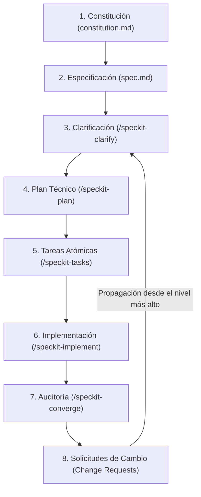

# 🎾 Spec-Driven Development (SDD) con Spec Kit y Antigravity CLI (`agy`)

Bienvenido al repositorio del curso y proyecto práctico de **Spec-Driven Development (SDD)**. En este espacio se aplican las metodologías y herramientas que transforman el desarrollo de software asistido por inteligencia artificial: pasando del código improvisado (*vibe coding*) a una arquitectura sólida, gobernada por contratos técnicos y especificaciones vivas.

El proyecto de demostración implementado es un **Sistema de Reservas de Canchas de Pádel** con catálogo cerrado, visualización de grilla horaria, prevención crítica de colisiones (*double-booking*), sesiones de usuario y gestión de turnos personales.

---

## 🚀 Principios de Spec-Driven Development

| Concepto | Vibe Coding tradicional | Spec-Driven Development (SDD) |
| :--- | :--- | :--- |
| **Fuente de la Verdad** | El código fuente (la documentación es un adorno opcional). | **La Especificación Técnica (`spec.md`)** y la **Constitución (`constitution.md`)**. |
| **Resiliencia al contexto** | Se satura el chat de la IA tras múltiples iteraciones (deuda técnica). | Documentos estructurados en el repositorio que sobreviven en el tiempo. |
| **Efecto Jenga** | Arreglar una feature rompe otra que ya funcionaba bien. | Cambios gobernados por niveles; el código es un subproducto de la spec. |
| **Spec Drift** | El código cambia pero los requerimientos quedan obsoletos. | **Cero Spec Drift**: todo cambio entra por el artefacto más alto de la cadena. |
| **Rol del desarrollador** | Supervisor reactivo de líneas de código y parches. | **Director de Producto** y Arquitecto que define el *qué* y el *porqué*. |

---

## 📂 Estructura del Repositorio

```text
Spec Drive/
├── README.md                      # Documentación general del repositorio y metodología
├── Clases.md                      # Resumen pedagógico y notas de las 13 clases del curso
├── comandos-consola.md            # Guía secuencial y práctica de todos los comandos de terminal
│
├── recursos/                      # Materiales base, especificaciones y borradores iniciales
│   ├── SPEC.md                    # Borrador inicial de especificación mínima (Clase 3)
│   ├── SPEC OK.md                 # Especificación funcional completa de entrada (Clase 6)
│   ├── constitution.md            # Reglas inquebrantables del proyecto base (Clase 5)
│   └── recurso-comandos-de-instalacion.pdf # Guía de instalación de herramientas
│
└── my-project/                    # Repositorio del proyecto real inicializado con Spec Kit
    ├── .specify/                  # Configuración, memoria, templates y workflows de Spec Kit
    │   ├── memory/constitution.md # Constitución ratificada del proyecto
    │   └── feature.json           # Puntero a la feature activa en desarrollo
    │
    ├── specs/001-court-booking-system/ # Especificación y artefactos generados por el ciclo SDD
    │   ├── spec.md                # Especificación funcional con clarificaciones integradas
    │   ├── plan.md                # Plan de arquitectura y chequeo constitucional
    │   ├── research.md            # Investigación de decisiones técnicas
    │   ├── data-model.md          # Modelo de datos de entidades (Usuario, Cancha, Reserva)
    │   ├── contracts/             # Contratos de API REST (endpoints y códigos de estado)
    │   ├── tasks.md               # Desglose de tareas atómicas ordenadas por fases
    │   ├── quickstart.md          # Guía de inicialización y validación del sistema
    │   └── checklists/            # Listas de control de calidad de requerimientos
    │
    ├── backend/                   # API REST en Node.js + Express + TypeScript + Vitest
    ├── frontend/                  # SPA en React + TypeScript + Vite + Tailwind CSS
    └── db/                        # Cliente SQLite nativo (better-sqlite3) y esquema padel.db
```

---

## 🛠️ Stack Tecnológico del Proyecto

- **Metodología y Framework**: [Spec Kit de GitHub](https://github.com/github/spec-kit) integrado con **Antigravity CLI (`agy`)**.
- **Frontend**: React 18, TypeScript, Tailwind CSS, Vite.
- **Backend**: Node.js, Express, TypeScript, cookies seguras / JWT.
- **Base de Datos**: SQLite local (`padel.db`) con sentencias SQL nativas (`better-sqlite3`), transacciones ACID para prevención de *double-booking*.
- **Testing**: Vitest + Supertest (pruebas de concurrencia, reglas de tiempo y cancelación).

---

## 🔄 El Ciclo de Vida SDD con Spec Kit y `agy`



1. **Constitución (`/speckit-constitution`)**: Reglas inquebrantables, stack permitido y principios inmutables.
2. **Especificación (`/speckit-specify`)**: Historias de usuario (P1, P2) con metodología **Given-When-Then** y requerimientos funcionales en sintaxis **EARS**.
3. **Clarificación (`/speckit-clarify`)**: Interrogatorio técnico para eliminar ambigüedades en edge cases (anticipación de cancelación, sesiones, etc.).
4. **Planificación (`/speckit-plan`)**: Traduce el *qué* al *cómo* técnico (arquitectura, modelos de datos y contratos).
5. **Tareas (`/speckit-tasks` y `/speckit-analyze`)**: Descompone el plan en tareas atómicas con dependencias y etiquetas `#p` para paralelismo.
6. **Implementación (`/speckit-implement`)**: El agente genera el código respetando la constitución (cero código sombra).
7. **Auditoría (`/speckit-converge`)**: Validación del comportamiento de la app contra las especificaciones.
8. **Gestión de Cambios sin Drift**: Si surge un nuevo requerimiento, se propaga desde la spec hacia abajo, nunca editando código a ciegas.

---

## ⚡ Guía Rápida para Ejecutar la Aplicación

Consulta la guía detallada paso a paso en [comandos-consola.md](comandos-consola.md).

### 1. Iniciar los Servicios en Local

Desde la carpeta `my-project/`:

```powershell
# Instalar dependencias si es la primera vez
npm --prefix backend install
npm --prefix frontend install

# Correr pruebas automatizadas
npm --prefix backend test

# Levantar el Backend (puerto 3001)
npm --prefix backend run dev

# Levantar el Frontend (puerto 5173 en otra terminal)
npm --prefix frontend run dev
```

Abre tu navegador en:
👉 **`http://localhost:5173`**

---

## 📖 Enlaces y Documentación de Apoyo

- 📘 [Clases.md](Clases.md): Apuntes y explicaciones detalladas clase por clase (Clases 1 a 13).
- 💻 [comandos-consola.md](comandos-consola.md): Listado ordenado de todos los comandos de Git, Spec Kit y agy.
- 📦 [recursos/](recursos/): Archivos fuente de requerimientos y constitución base.
- 📋 [quickstart.md](my-project/specs/001-court-booking-system/quickstart.md): Escenarios de validación interactiva de la aplicación.
