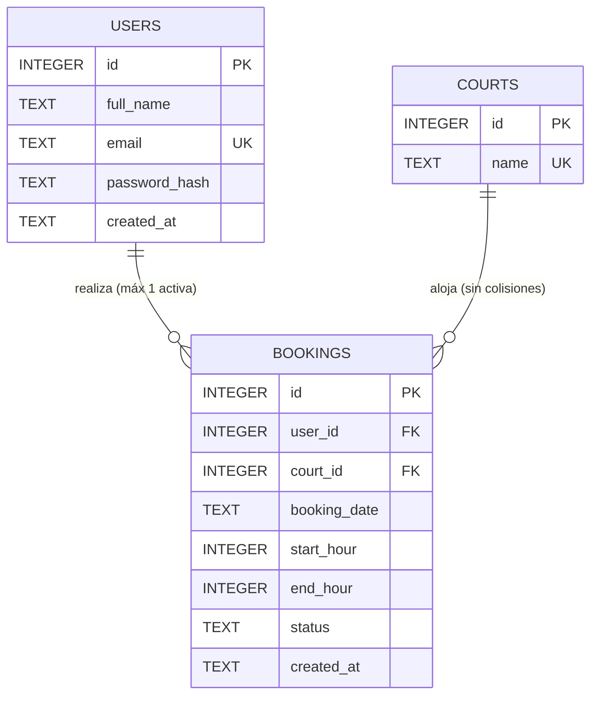

# Phase 1: Data Model (`padel.db`)

**Feature**: Court Booking System (`001-court-booking-system`)  
**Database Engine**: SQLite 3 via `better-sqlite3` (`/db/padel.db`)  
**Date**: 2026-10-17

## 1. Entity Relationship Overview



---

## 2. Entities & Schema Definition

### 2.1 `users` (Usuario)
Representa al jugador registrado en la plataforma.

| Column | Type | Constraints | Description |
|--------|------|-------------|-------------|
| `id` | `INTEGER` | `PRIMARY KEY AUTOINCREMENT` | Identificador único del usuario |
| `full_name` | `TEXT` | `NOT NULL` | Nombre completo del jugador (mín. 2 caracteres) |
| `email` | `TEXT` | `NOT NULL UNIQUE COLLATE NOCASE` | Correo electrónico único (normalizado a minúsculas) |
| `password_hash` | `TEXT` | `NOT NULL` | Hash seguro de la contraseña (mín. 8 caracteres en texto plano al registrarse) |
| `created_at` | `TEXT` | `NOT NULL DEFAULT (datetime('now'))` | Fecha/hora de creación en ISO 8601 |

**Validation Rules (FR-001)**:
- `full_name`: Requerido, no vacío tras `trim()`.
- `email`: Formato de correo electrónico estándar válido (`/^[^\s@]+@[^\s@]+\.[^\s@]+$/`).
- `password`: Mínimo 8 caracteres antes de aplicar hashing.

---

### 2.2 `courts` (Cancha)
Representa el catálogo cerrado e inmutable de 5 canchas en Medellín y el Valle de Aburrá.

| Column | Type | Constraints | Description |
|--------|------|-------------|-------------|
| `id` | `INTEGER` | `PRIMARY KEY` | Identificador fijo (`1` a `5`) |
| `name` | `TEXT` | `NOT NULL UNIQUE` | Nombre oficial inmutable de la cancha |

**Seed Data Inmutable (FR-004 & Constitution Principle II)**:
1. `(1, 'Cancha Laureles')`
2. `(2, 'Cancha El Poblado')`
3. `(3, 'Cancha Belén')`
4. `(4, 'Cancha Robledo')`
5. `(5, 'Cancha Envigado')`

> No existen endpoints ni operaciones de escritura (`INSERT`/`UPDATE`/`DELETE`) expuestos para modificar esta tabla tras la inicialización (semilla idempotente).

---

### 2.3 `bookings` (Reserva)
Representa la asignación exclusiva de un bloque de 1 hora en una cancha y fecha determinadas.

| Column | Type | Constraints | Description |
|--------|------|-------------|-------------|
| `id` | `INTEGER` | `PRIMARY KEY AUTOINCREMENT` | Identificador único de la reserva |
| `user_id` | `INTEGER` | `NOT NULL REFERENCES users(id)` | Usuario propietario de la reserva |
| `court_id` | `INTEGER` | `NOT NULL REFERENCES courts(id)` | Cancha reservada (`1..5`) |
| `booking_date` | `TEXT` | `NOT NULL` | Fecha calendario en formato `YYYY-MM-DD` (zona `America/Bogota`) |
| `start_hour` | `INTEGER` | `NOT NULL CHECK (start_hour >= 0 AND start_hour <= 23)` | Hora de inicio en formato 24h entero (`0` = 00:00, `14` = 14:00, `23` = 23:00) |
| `end_hour` | `INTEGER` | `NOT NULL CHECK (end_hour = start_hour + 1)` | Hora de fin (`1` a `24`, donde `24` = 24:00 / fin del día) |
| `status` | `TEXT` | `NOT NULL DEFAULT 'ACTIVE' CHECK (status IN ('ACTIVE', 'CANCELLED'))` | Estado persistido (`ACTIVE` o `CANCELLED`) |
| `created_at` | `TEXT` | `NOT NULL DEFAULT (datetime('now'))` | Fecha y hora de creación de la reserva |

---

## 3. Índices y Garantías de Integridad (Critical Constraints)

```sql
-- 1. Prevención absoluta de colisiones (Double-Booking) a nivel de motor SQLite (FR-009)
CREATE UNIQUE INDEX IF NOT EXISTS idx_bookings_active_slot
ON bookings (court_id, booking_date, start_hour)
WHERE status = 'ACTIVE';

-- 2. Índice para consulta rápida de reservas por usuario y estado (FR-010, FR-011)
CREATE INDEX IF NOT EXISTS idx_bookings_user_status
ON bookings (user_id, status, booking_date, end_hour);
```

---

## 4. Reglas de Estado y Transiciones (Lifecycle)

El ciclo de vida de una reserva combina el campo persistido `status` (`ACTIVE` | `CANCELLED`) con la evaluación temporal respecto a la hora actual en Colombia (`America/Bogota`, UTC-5):

1. **Creación (` Reservado / Activa `)**:
   - Precondición 1 (Sin Pasado - FR-008): El instante de inicio `(booking_date + start_hour:00)` DEBE ser estrictamente posterior al instante actual (`now_bogota`).
   - Precondición 2 (Sin Colisión - FR-009): No existe ningún registro en `bookings` con el mismo `(court_id, booking_date, start_hour)` y `status = 'ACTIVE'`.
   - Precondición 3 (Reserva Activa Única - FR-010): El usuario (`user_id`) no posee ningún registro con `status = 'ACTIVE'` cuyo instante de finalización `(booking_date + end_hour:00)` sea mayor al instante actual (`end_timestamp > now_bogota`).
   - Acción: Se inserta con `status = 'ACTIVE'`.

2. **Finalización Natural (` Completada `)**:
   - Transición automática por paso del tiempo cuando `status = 'ACTIVE'` y `end_timestamp <= now_bogota` (`hora_fin <= hora_actual`).
   - Efecto:
     - Deja inmediatamente de bloquear nuevas reservas para el usuario (FR-010).
     - Aparece en la lista de **Historial de reservas pasadas completadas** dentro de "Mis Reservas" (FR-011).
     - No puede ser cancelada (FR-014).

3. **Cancelación por el Usuario (` Cancelada `)**:
   - Precondición 1 (Propiedad - FR-003): `booking.user_id === authenticatedUserId`.
   - Precondición 2 (Anticipación mínima de 1 hora - FR-013, FR-014): `start_timestamp - now_bogota >= 3600 segundos (60 minutos)`.
   - Acción: `UPDATE bookings SET status = 'CANCELLED' WHERE id = ?`.
   - Efecto:
     - El índice parcial `idx_bookings_active_slot` libera inmediatamente el bloque `(court_id, booking_date, start_hour)` para cualquier usuario (SC-003).
     - El usuario queda libre de la restricción de reserva activa única y puede agendar un nuevo turno.
     - La reserva se oculta del panel "Mis Reservas" (FR-011).

---

## 5. TypeScript Domain Interfaces (`PascalCase`)

```typescript
export interface User {
  id: number;
  fullName: string;
  email: string;
  createdAt: string;
}

export interface Court {
  id: number;
  name:
    | 'Cancha Laureles'
    | 'Cancha El Poblado'
    | 'Cancha Belén'
    | 'Cancha Robledo'
    | 'Cancha Envigado';
}

export interface TimeSlot {
  startHour: number; // 0..23
  endHour: number;   // 1..24
  label: string;     // ej. "14:00 - 15:00"
  status: 'AVAILABLE' | 'BOOKED';
  isPast: boolean;
  bookedByCurrentUser: boolean;
}

export interface BookingSummary {
  id: number;
  userId: number;
  courtId: number;
  courtName: string;
  bookingDate: string; // "YYYY-MM-DD"
  startHour: number;   // 0..23
  endHour: number;     // 1..24
  timeRangeLabel: string; // "14:00 - 15:00"
  canCancel: boolean;  // true si faltan >= 60 min para startHour
  createdAt: string;
}
```
